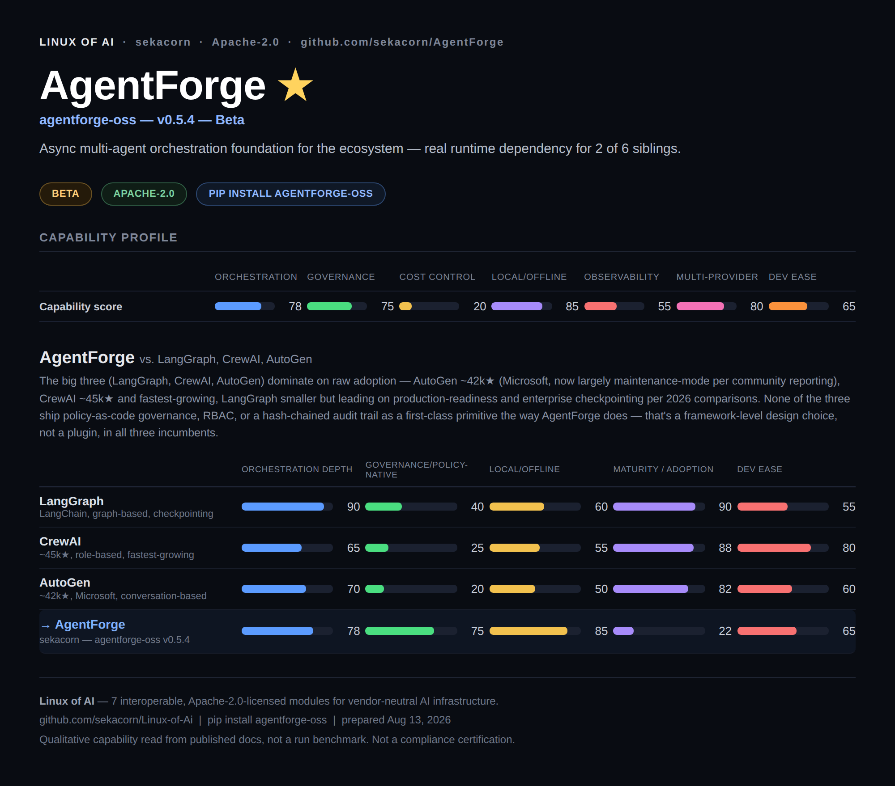
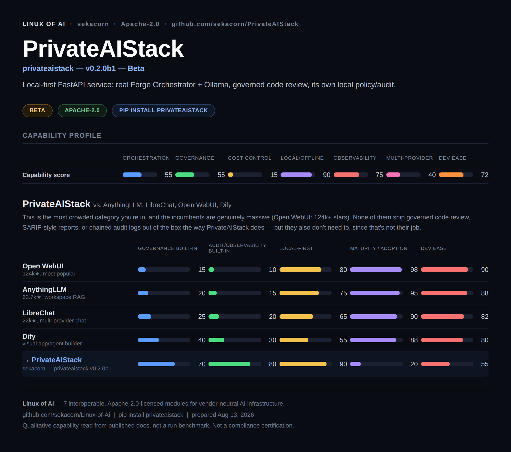
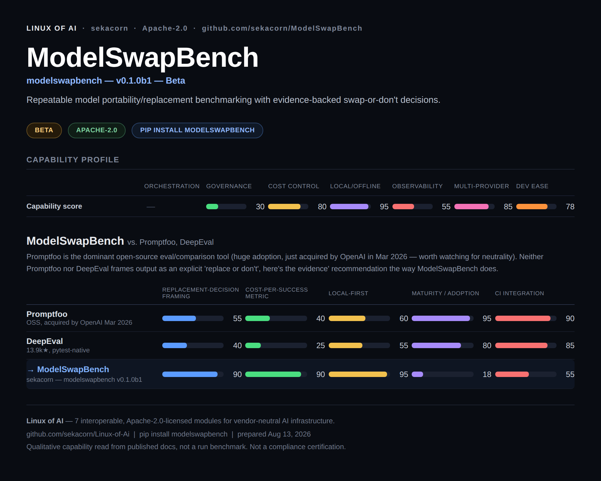
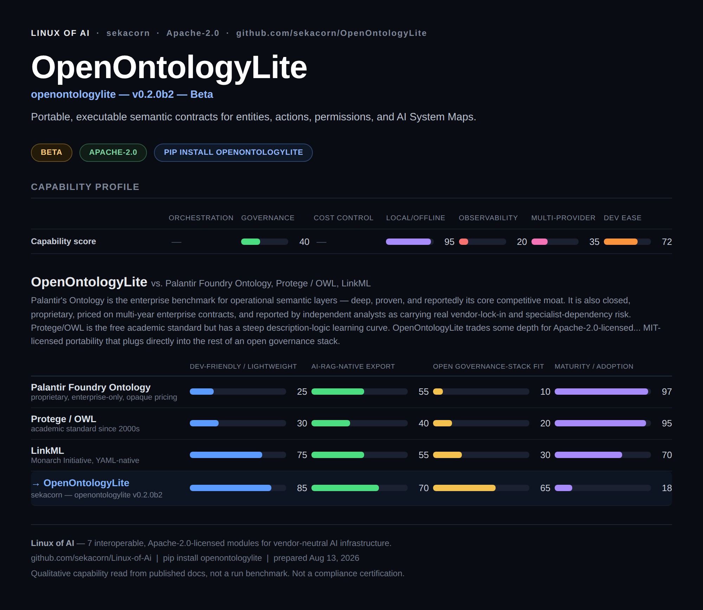
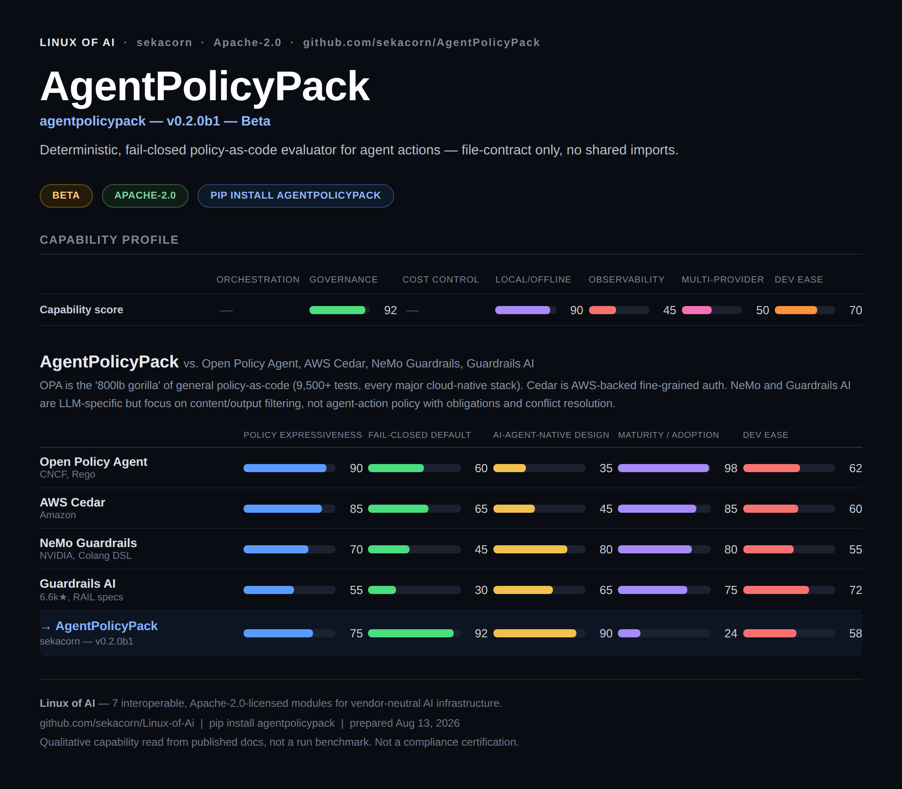
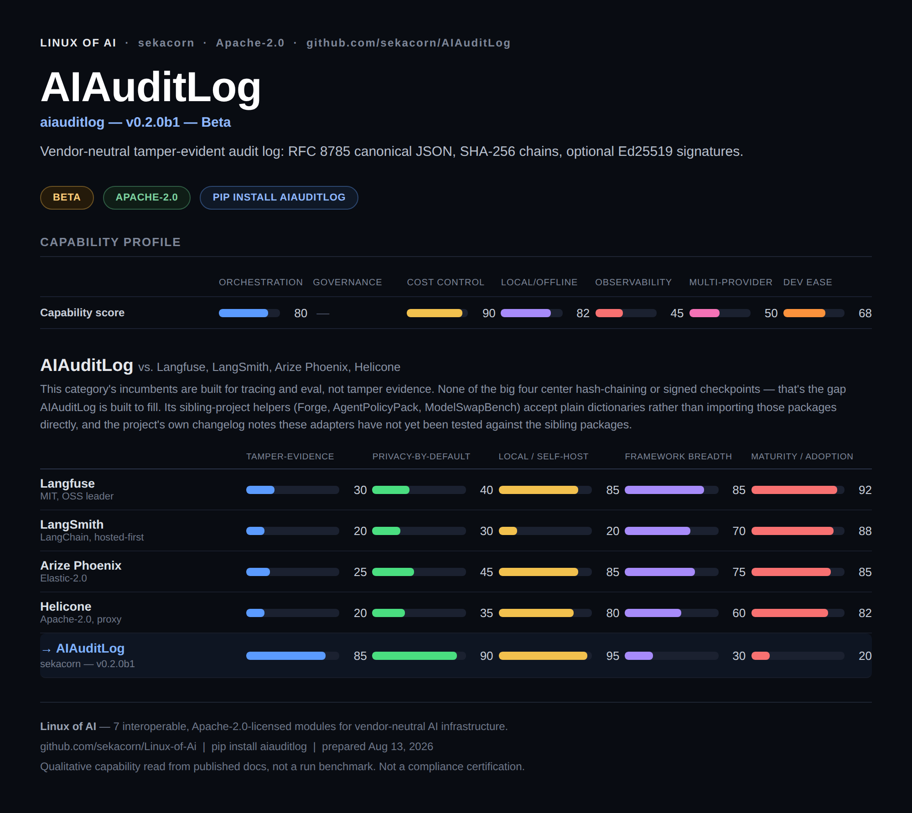
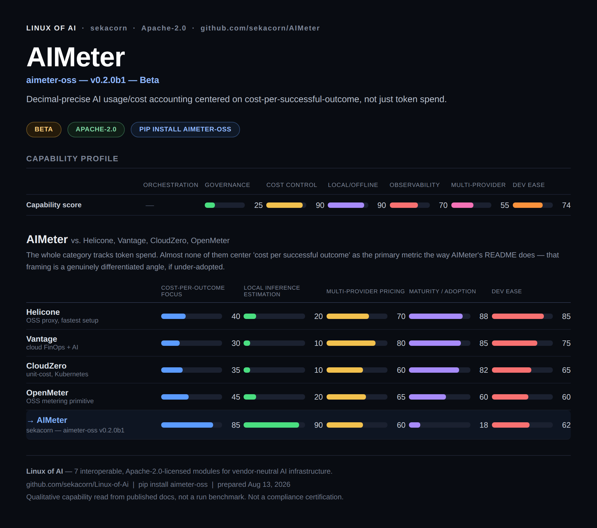

# Linux of AI

<p align="center">
  <strong>Free, open, portable AI infrastructure for everyone.</strong>
</p>

<p align="center">
  Build AI systems that are inspectable, governed, measurable, replaceable, and not trapped inside a single vendor.
</p>

<p align="center">
  <a href="#the-mission">Mission</a> •
  <a href="#the-problem">The Problem</a> •
  <a href="#the-eight-projects">Projects</a> •
  <a href="#ecosystem-screenshots">Screenshots</a> •
  <a href="#architecture">Architecture</a> •
  <a href="#principles">Principles</a> •
  <a href="#get-started">Get Started</a>
</p>

## Start Here

New to Linux of AI? Start with the [Start Here guide](docs/start-here.md) to choose the right tool for your problem.

You can also inspect the [Linux of AI Vendor Exit Demo](examples/vendor-exit-demo/) to see the ecosystem pattern in one deterministic, offline-first example.

## Quickstart Kit

New to Linux of AI? Generate a complete offline vendor-exit workspace:

```bash
python scripts/create_vendor_exit_project.py my-ai-exit-check
cd my-ai-exit-check
python run.py
```

The quickstart creates a fictional customer-support AI workload with:

- an AI System Map;
- a policy file;
- model comparison inputs;
- an AI Vendor Exit Report;
- a Model Routing Plan;
- AIMeter OSS-style cost and outcome summaries;
- AIAuditLog-style audit events;
- a Mermaid diagram.

It uses deterministic fixture data, requires only the Python standard library, and makes no external API calls. See the [Quickstart Kit guide](docs/quickstart-kit.md) for the generated file map, replacement workflow, and limitations.

## Flagship Demo

The [Linux of AI Vendor Exit Demo](examples/vendor-exit-demo/) shows how the ecosystem can help a team evaluate replacing an expensive or locked-in AI model using portable ontology, policy, benchmarking, audit evidence, and cost/outcome measurement.

This demo is deterministic and offline-first. It demonstrates the integration
pattern using portable files and reports, including AIMeter OSS-style
cost/outcome JSON and AIAuditLog-style audit-event JSONL exports from the model
replacement decision.

ModelSwapBench can now produce both an AI Vendor Exit Report and a Model
Routing Plan, helping teams decide not only whether a model can be replaced, but
which tasks can move safely, which need human review, and which should stay on
the baseline model.

## Project Status

| Project | PyPI package | Role | Status |
|---|---|---|---|
| AgentForge | agentforge-oss | Agent orchestration | Published |
| PrivateAIStack | privateaistack | Private/local deployment | Published |
| ModelSwapBench | modelswapbench | Model replacement and vendor-exit reports | Published; includes AI Vendor Exit Report |
| OpenOntologyLite | openontologylite | Portable ontology, business meaning, and AI workload maps | Published |
| AgentPolicyPack | agentpolicypack | Policy-as-code for agents | Published |
| AIAuditLog | aiauditlog | AI audit evidence | Published |
| AIMeter OSS | aimeter-oss | AI cost, usage, efficiency, and outcome measurement | Published |
| AI Infrastructure Suite | ai-infrastructure-suite | Unified ecosystem installation and compatibility diagnostics | Published |

## Ecosystem Screenshots

### AgentForge

<a href="01-agentforge.png">
  
</a>

### PrivateAIStack

<a href="02-privateaistack.png">
  
</a>

### ModelSwapBench

<a href="03-modelswapbench.png">
  
</a>

### OpenOntologyLite

<a href="04-openontologylite.png">
  
</a>

### AgentPolicyPack

<a href="05-agentpolicypack.png">
  
</a>

### AIAuditLog

<a href="06-aiauditlog.png">
  
</a>

### AIMeter OSS

<a href="07-aimeter.png">
  
</a>

## What This Is Not

Linux of AI is not:

- a foundation model;
- a hosted AI provider;
- a compliance certification;
- a legal guarantee;
- a replacement for human review in high-risk workflows;
- proof that any model migration is automatically safe.

It is open infrastructure for building, evaluating, governing, auditing, and measuring AI systems.

## Best First Path

If you are new, start here:

1. Generate a workspace with `python scripts/create_vendor_exit_project.py my-ai-exit-check`
2. Run the generated `run.py` and inspect its AI System Map and reports
3. Read [docs/start-here.md](docs/start-here.md)
4. Run or inspect [examples/vendor-exit-demo/](examples/vendor-exit-demo/)
5. Try the individual packages for deeper validation and runtime workflows

---

## The Mission

**Linux of AI** is an eight-project open-source ecosystem created to reduce vendor lock-in and make practical AI infrastructure available to everyone.

The goal is simple:

> **No organization should be forced to surrender control of its AI systems, data, costs, policies, or future to a single vendor.**

AI is becoming critical infrastructure. But many organizations are discovering that the systems they built are difficult to move, difficult to inspect, difficult to govern, and increasingly expensive to operate.

This ecosystem exists to provide another path.

A path where AI infrastructure is:

- **Portable** across models, providers, and environments
- **Inspectable** instead of hidden behind opaque services
- **Governed** through explicit policies
- **Measurable** in cost, usage, efficiency, and outcomes
- **Replaceable** when a model or provider no longer serves the user
- **Local-first** where privacy or control matters
- **Free and open source** for public benefit

This software is intended to remain available to developers, researchers, nonprofits, businesses, governments, students, and communities without placing the core infrastructure behind a paywall.

---

## The Problem

Organizations adopting AI repeatedly encounter the same pain points.

### Vendor lock-in

Applications become tightly coupled to one model provider, SDK, API format, pricing model, or hosted platform. Replacing the provider later can require major rewrites.

### Unpredictable token costs

A prototype may be affordable, but production usage can grow rapidly. Teams often lack clear controls for routing, budgeting, measuring cost, and comparing alternatives.

### No practical replacement path

Organizations may know they are overpaying or underperforming, but they lack a repeatable way to test another model without disrupting the application.

### Weak governance

AI agents can call tools, access data, and make decisions without clear, portable rules governing what they are allowed to do.

### Limited operational evidence

Logs are often inconsistent, provider-specific, incomplete, or difficult to verify after the fact.

### Fragmented measurement

API success does not necessarily mean business success. Many systems track requests and tokens but not whether the AI produced an acceptable outcome.

### Loss of organizational meaning

Business concepts, relationships, permissions, and actions are frequently embedded directly inside application code, making systems difficult to understand and migrate.

### Privacy and deployment constraints

Some organizations cannot send sensitive data to external providers. They need local or controlled deployment options that do not require rebuilding the entire stack.

Linux of AI addresses these problems as one connected ecosystem.

---

## The Eight Projects

| Layer | Project | What it solves | Repository | PyPI |
|---|---|---|---|---|
| Organizational meaning | **OpenOntologyLite** | Defines portable entities, relationships, actions, permissions, and business meaning outside application code | [GitHub](https://github.com/sekacorn/OpenOntologyLite) | [PyPI](https://pypi.org/project/openontologylite/) |
| Governance | **AgentPolicyPack** | Provides portable policy-as-code for governing AI agents and agentic workflows | [GitHub](https://github.com/sekacorn/AgentPolicyPack) | [PyPI](https://pypi.org/project/agentpolicypack/) |
| Orchestration | **AgentForge** | Coordinates multi-agent systems with model routing, budgets, governance, memory, and observability | [GitHub](https://github.com/sekacorn/AgentForge) | [PyPI](https://pypi.org/project/agentforge-oss/) |
| Private deployment | **PrivateAIStack** | Provides a local-first starting point for private AI, local models, RAG, code review, auditing, and controlled deployment | [GitHub](https://github.com/sekacorn/PrivateAIStack) | [PyPI](https://pypi.org/project/privateaistack/) |
| Model replacement | **ModelSwapBench** | Tests whether another model can deliver an acceptable outcome at lower cost, latency, or operational risk | [GitHub](https://github.com/sekacorn/ModelSwapBench) | [PyPI](https://pypi.org/project/modelswapbench/) |
| Operational evidence | **AIAuditLog** | Defines a portable, tamper-evident audit-event format and local toolkit for AI systems and agents | [GitHub](https://github.com/sekacorn/AIAuditLog) | [PyPI](https://pypi.org/project/aiauditlog/) |
| Cost and outcomes | **AIMeter OSS** | Measures AI usage, cost, efficiency, and business outcomes without assuming provider billing equals business value | [GitHub](https://github.com/sekacorn/AIMeter) | [PyPI](https://pypi.org/project/aimeter-oss/) |
| Ecosystem setup | **AI Infrastructure Suite** | Provides a unified installer and compatibility diagnostics while keeping each project independently usable | [GitHub](https://github.com/sekacorn/AI-Infrastructure-Suite) | [PyPI](https://pypi.org/project/ai-infrastructure-suite/) |

---

## Architecture

```text
OpenOntologyLite
        │
        ▼
Portable organizational meaning
        │
        ▼
AgentPolicyPack
        │
        ▼
Portable governance rules
        │
        ▼
AgentForge
        │
        ▼
Portable agent orchestration
        │
        ▼
PrivateAIStack
        │
        ▼
Private and controlled deployment
        │
        ▼
ModelSwapBench
        │
        ▼
Model replacement and economics verification
        │
        ▼
AIAuditLog
        │
        ▼
Portable tamper-evident operational evidence
        │
        ▼
AIMeter OSS
        │
        ▼
Usage, cost, efficiency, and outcome measurement
```

**AI Infrastructure Suite** sits alongside these independently usable components as a lightweight installer and compatibility layer. It does not replace their packages or add their business logic.

Each project can be used independently. Together, they form a portable foundation for building AI systems without making one provider the permanent center of the architecture.

---

## How Each Project Helps

### OpenOntologyLite

**Pain point:** Organizational knowledge is buried inside source code, database schemas, prompts, and vendor-specific platforms.

**What it provides:**

- Portable ontology definitions in YAML or JSON
- Typed entities, properties, relationships, and actions
- Permissions and preconditions
- Defines portable AI System Maps for tasks, risk levels, allowed model routes, human-review rules, audit expectations, and cost/outcome measurement expectations
- Validation and canonical representation
- Diffing, inspection, documentation, and diagram export

The vendor-exit demo includes a portable [AI System Map](examples/vendor-exit-demo/ontology/ai_system_map.yaml) that assigns each customer-support task to `candidate_model`, `baseline_model`, `human_review`, or `blocked_or_escalate` paths. Its ecosystem entries document integration patterns only; they do not claim verified live integrations between the projects.
- Local-first and offline operation

**Why it matters:**  
Your organization’s meaning should belong to your organization, not to a proprietary platform.

---

### AgentPolicyPack

**Pain point:** Agent behavior is often governed by scattered prompt instructions and application-specific checks.

**What it provides:**

- Portable policy-as-code
- Explicit rules for agent actions
- Reusable governance across systems
- A foundation for reviewable and testable agent behavior

**Why it matters:**  
Governance should be visible, portable, and separate from the model itself.

---

### AgentForge

**Pain point:** Multi-agent systems become tightly coupled to one provider, one orchestration framework, or one pricing model.

**What it provides:**

- Multi-agent orchestration
- Supervisor and worker patterns
- Model routing
- Budget controls
- Role-based access control
- Policy integration
- Memory options
- Audit logging
- Observability support
- Multiple provider paths

**Why it matters:**  
The orchestration layer should make models replaceable rather than make lock-in stronger.

---

### PrivateAIStack

**Pain point:** Many organizations need AI capabilities but cannot send all data to external services.

**What it provides:**

- Local-first AI deployment
- Ollama-backed local models
- FastAPI-based services
- PostgreSQL and pgvector support
- Local retrieval-augmented generation
- Governed code review
- Audit events
- Optional observability

**Why it matters:**  
Privacy, local control, and portability should be practical options, not enterprise luxuries.

---

### ModelSwapBench

**Pain point:** Teams cannot easily prove whether another model is good enough to replace their current provider.

**What it provides:**

- Repeatable model comparison
- Outcome-based evaluation
- Cost and latency comparison
- Provider replacement testing
- Evidence for model-routing and migration decisions

**Why it matters:**  
A model should earn its place through measured performance, not remain because switching feels too difficult.

---

### AIAuditLog

**Pain point:** AI logs are inconsistent, incomplete, and often locked into provider-specific systems.

**What it provides:**

- A portable audit-event format
- Local audit tooling
- Hash chaining for tamper evidence
- Consistent operational evidence across AI systems

**Important boundaries:**

- Tamper-evident does not mean immutable
- A signature does not prove real-world identity by itself
- Audit logs do not automatically create legal non-repudiation
- Using the format does not automatically create regulatory compliance

**Why it matters:**  
Organizations need evidence they can retain, inspect, export, and understand independently of a vendor.

---

### AIMeter OSS

**Pain point:** Token counts and API bills do not explain whether an AI system is efficient or useful.

**What it provides:**

- Usage measurement
- Cost calculation using precise decimal arithmetic
- Efficiency analysis
- Outcome tracking
- Budget evaluation
- Provider and model comparison

**Important boundaries:**

- Missing pricing is never treated as zero
- Calculated cost is not invoice-confirmed cost
- Projected savings are not realized savings
- API success is not automatically business success
- Budgets are evaluated, not automatically enforced

**Why it matters:**  
AI economics should be measured in terms of cost and acceptable outcomes, not tokens alone.

---

## Principles

### Free at the core

The core software is free and open source under the Apache License 2.0.

### No forced vendor dependency

The ecosystem is designed to keep models, providers, and deployment environments replaceable.

### Honest claims

The projects should not claim tests, integrations, security guarantees, compliance, publication status, or verification unless those claims were actually demonstrated.

### Local control matters

Organizations should be able to run critical parts of their AI infrastructure locally or inside environments they control.

### Measurement before loyalty

Models and providers should be selected based on measured outcomes, cost, latency, privacy, and operational needs.

### Governance should travel with the system

Policies, organizational meaning, audit evidence, and measurements should remain portable when the model or provider changes.

### Open infrastructure is a public good

AI infrastructure should not be available only to the largest companies. Smaller organizations, public institutions, researchers, and independent developers should have access to practical alternatives.

---

## Who This Is For

Linux of AI is intended for:

- Developers building AI applications
- Teams trying to reduce model-provider dependency
- Organizations facing rising token costs
- Businesses evaluating local or private AI
- Researchers who need inspectable infrastructure
- Nonprofits and public-interest organizations
- Governments and regulated environments
- Platform teams building internal AI capabilities
- Anyone who believes critical AI infrastructure should remain open

---

## Get Started

Install individual projects from PyPI:

```bash
pip install agentforge-oss
pip install privateaistack
pip install modelswapbench
pip install openontologylite
pip install agentpolicypack
pip install aiauditlog
pip install aimeter-oss
pip install ai-infrastructure-suite
```

AI Infrastructure Suite provides the `ai-suite` installer and compatibility diagnostics. The individual projects remain independently installable and usable.

Supported Python versions:

```text
Python 3.11–3.13
```

Visit each repository for project-specific installation instructions, examples, limitations, and documentation.

---

## Project Links

- [AgentForge](https://github.com/sekacorn/AgentForge)
- [PrivateAIStack](https://github.com/sekacorn/PrivateAIStack)
- [ModelSwapBench](https://github.com/sekacorn/ModelSwapBench)
- [OpenOntologyLite](https://github.com/sekacorn/OpenOntologyLite)
- [AgentPolicyPack](https://github.com/sekacorn/AgentPolicyPack)
- [AIAuditLog](https://github.com/sekacorn/AIAuditLog)
- [AIMeter OSS](https://github.com/sekacorn/AIMeter)

GitHub organization and public work:

- [github.com/sekacorn](https://github.com/sekacorn)

---

## Contributing

Contributions are welcome.

Useful contributions include:

- Documentation improvements
- Bug reports with reproducible examples
- Tests across Python 3.11–3.13
- Provider adapters
- Model-evaluation scenarios
- Policy examples
- Ontology examples
- Audit-event integrations
- Cost and outcome measurement adapters
- Accessibility improvements
- Security reviews
- Packaging and release improvements

Please read the contribution guidance in the individual project repository before submitting changes.

---

## Sustainability

Free software still requires maintenance.

The long-term goal is to keep the core ecosystem free while supporting sustainability through methods such as:

- Community contributions
- Sponsorships
- Grants
- Research partnerships
- Public-interest funding
- Optional implementation support
- Optional training and consulting

The mission is not to place the core infrastructure behind a paywall. The mission is to keep it useful, maintained, and available.

---

## License

All projects in the Linux of AI ecosystem use the **Apache License 2.0**, unless a repository explicitly states otherwise.

---

## Final Statement

> AI should expand human capability without forcing humanity into permanent dependence on a small number of vendors.

Linux of AI exists so that organizations can understand their systems, control their costs, govern their agents, preserve their knowledge, replace their models, retain their evidence, and measure whether AI is actually helping.

**Free infrastructure. Portable systems. Human control.**
